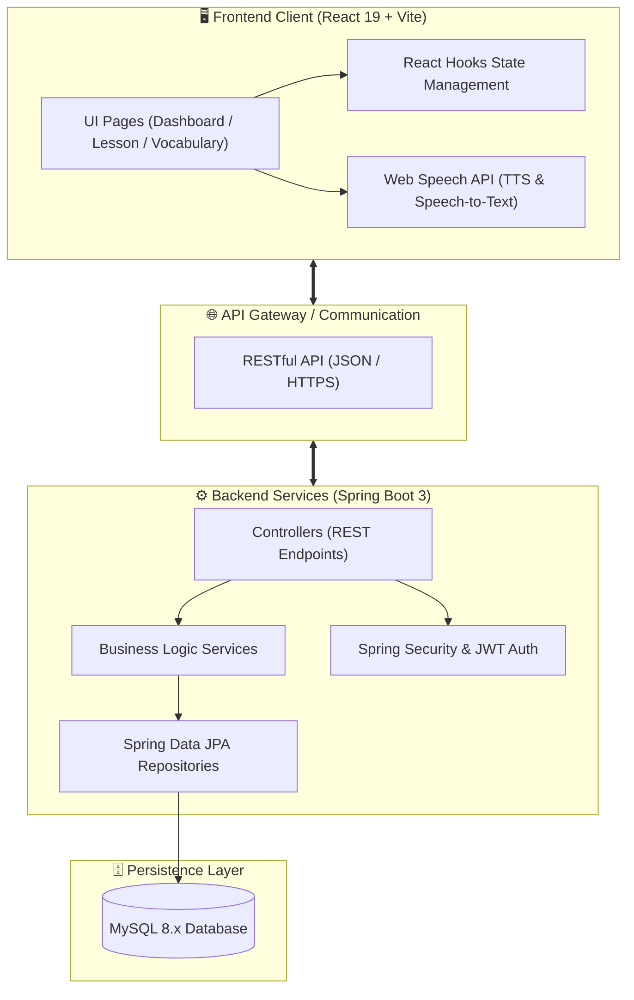
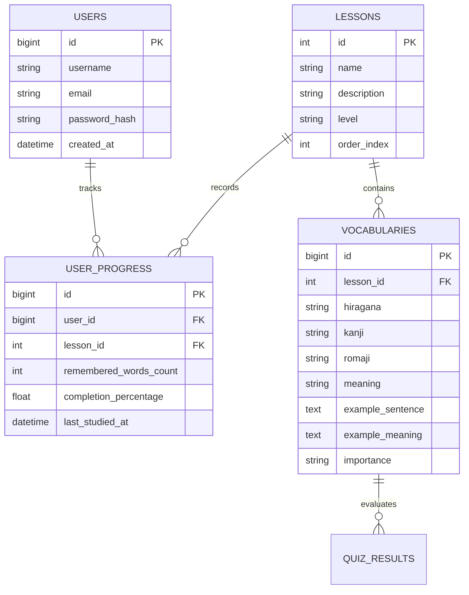

<div align="center">

# 🇯🇵 NIHONGOSTEP
### *Nền tảng học tiếng Nhật trực tuyến theo phương pháp đa giác quan & lộ trình JLPT N5 → N4*

[](https://react.dev/)
[](https://vitejs.dev/)
[](https://spring.io/projects/spring-boot)
[](https://www.mysql.com/)
[](https://developer.mozilla.org/en-US/docs/Web/API/Web_Speech_API)
[](LICENSE)

<p align="center">
  <a href="#-tổng-quan--bối-cảnh-dự-án">Tổng quan</a> •
  <a href="#-kiến-trúc-hệ-thống--công-nghệ">Kiến trúc</a> •
  <a href="#-tính-năng-cốt-lõi">Tính năng</a> •
  <a href="#-mô-hình-dữ-liệu--data-contracts">Mô hình dữ liệu</a> •
  <a href="#-thiết-kế-restful-api">REST API</a> •
  <a href="#-cấu-trúc-thư-mục">Cấu trúc thư mục</a> •
  <a href="#-hướng-dẫn-cài-đặt">Cài đặt</a> •
  <a href="#-lộ-trình-phát-triển-roadmap">Roadmap</a>
</p>

</div>

---

## 🧭 Tổng quan & Bối cảnh dự án

### 1. Vấn đề thực tế
Học tiếng Nhật ở giai đoạn sơ cấp (**JLPT N5 / N4**) thường gặp các rào cản lớn:
- **Khối lượng ghi nhớ quá tải:** 3 hệ chữ (Hiragana, Katakana, Kanji) khiến người học dễ lẫn lộn và chán nản.
- **Học thụ động (Passive Learning):** Chỉ đọc thuộc lòng bảng từ vựng dẫn đến tình trạng "nhìn thì hiểu nhưng không nghe được và không nói được".
- **Thiếu công cụ đo lường liên tục:** Các trang web tĩnh hiện nay ít có cơ chế theo dõi tiến độ từng bài và gợi ý từ vựng cần ôn lại.

### 2. Giải pháp của NihongoStep
**NihongoStep** được định hình là một nền tảng **Học tập đa giác quan (Multi-sensory Learning)** kết hợp mô hình **Micro-learning (chia nhỏ bài học)**:
- **Nghe - Nhìn - Gõ - Nói:** Kết hợp đồng thời 6 phương thức tương tác trong một bài học.
- **Data-Driven & Decoupled:** Thiết kế tách biệt tuyệt đối giữa tầng hiển thị (Presentation Layer) và dữ liệu bài học (Data Layer), cho phép mở rộng không giới hạn số lượng bài và từ mà không sửa đổi logic mã nguồn.
- **Chuyển đổi linh hoạt từ Client-side sang Full-stack:** Được khởi tạo với kiến trúc component chuẩn hóa, sẵn sàng tích hợp với Backend Spring Boot và cơ sở dữ liệu quan hệ MySQL.

---

## 🏛️ Kiến trúc hệ thống & Công nghệ

### 1. Sơ đồ kiến trúc tổng thể (System Architecture)



### 2. Bảng phân tích lựa chọn công nghệ (Tech Stack Rationales)

| Tầng | Công nghệ | Phiên bản | Lý do lựa chọn & Vai trò trong dự án |
|---|---|---|---|
| **Frontend Framework** | **React** | 19.x | Component-based, Virtual DOM tối ưu tốc độ render, hỗ trợ React hooks quản lý state linh hoạt cho các card tương tác. |
| **Build Tool** | **Vite** | 8.x | Tốc độ khởi động siêu tốc qua Native ESM, Hot Module Replacement (HMR) tức thì giúp nâng cao năng suất lập trình. |
| **Giao diện & Styling** | **Vanilla CSS** | CSS3 | Toàn quyền kiểm soát layout, không bị phình to bundle size như các CSS framework cồng kềnh, tối ưu CSS variables cho dark/light theme sau này. |
| **Xử lý âm thanh** | **Web Speech API** | W3C Standard | Tích hợp tính năng phát âm (SpeechSynthesis) và nhận diện giọng nói (SpeechRecognition) trực tiếp trên trình duyệt mà không tốn chi phí API bên thứ ba. |
| **Backend (Dự kiến)** | **Spring Boot** | 3.x (Java 17+) | Khung ứng dụng Java chuẩn doanh nghiệp, mạnh mẽ, độ tin cậy cao, kiến trúc phân tầng rõ ràng (Controller-Service-Repository). |
| **Bảo mật (Dự kiến)** | **Spring Security + JWT** | Latest | Xác thực người dùng không trạng thái (stateless), bảo vệ các endpoint tiến độ học tập và dữ liệu tài khoản. |
| **Cơ sở dữ liệu** | **MySQL** | 8.x | Cơ sở dữ liệu quan hệ ACID, bảo đảm tính toàn vẹn dữ liệu giữa người dùng, bài học, từ vựng và lịch sử luyện tập. |
| **Code Quality** | **Oxlint** | 1.8x | Công cụ linter hiệu năng cao bằng Rust, rà soát lỗi cú pháp nhanh gấp hàng chục lần so với ESLint truyền thống. |

---

## ⚡ Tính năng cốt lõi (Core Features)

### 1. Hệ thống 6 chế độ học tập đa phương pháp (Multi-mode Learning)
Mỗi bài học được trang bị bộ điều khiển linh hoạt cho phép người dùng chuyển đổi chế độ học chỉ với một cú click:

```
[📖 Xem từ] ➔ [🧠 Học thẻ Flashcard] ➔ [✓ Quiz trắc nghiệm] ➔ [⌨ Gõ từ] ➔ [🔊 Luyện nghe] ➔ [🎤 Luyện phát âm]
```

1. **📖 Xem từ (Vocabulary Overview - `view`):**
   - Danh sách thẻ từ vựng trực quan: Hiển thị Kanji, Hiragana (Furigana), Romaji, nghĩa tiếng Việt, câu ví dụ thực tế và độ quan trọng (`high` / `medium`).
2. **🧠 Học từ với Flashcard 2 mặt (`study`):**
   - Thẻ lật 3D sinh động: Mặt trước là chữ tiếng Nhật, mặt sau là phiên âm, nghĩa và câu ví dụ.
   - Cơ chế tự đánh giá: Nút **"Đã nhớ"** và **"Chưa nhớ"** cập nhật trực tiếp tiến độ bài học theo thời gian thực.
3. **✓ Quiz trắc nghiệm phản xạ (`quiz`):**
   - Thuật toán sinh câu hỏi tự động: Lấy ngẫu nhiên các từ trong bài làm phương án nhiễu (distractors), xáo trộn đáp án.
   - Hệ thống chấm điểm trực quan: Tính tổng điểm và đưa ra thông báo tổng kết khi hoàn thành bài quiz.
4. **⌨ Luyện gõ từ vựng (`type`):**
   - Kiểm tra khả năng gõ Romaji và chuyển đổi Hiragana, giúp người học làm quen với thao tác gõ bàn phím tiếng Nhật thực tế.
5. **🔊 Luyện nghe chủ động (`listen`):**
   - Tận dụng `SpeechSynthesisUtterance` với `lang: "ja-JP"`, cho phép người học nghe đi nghe lại âm đọc chuẩn bản ngữ ở các tốc độ khác nhau.
6. **🎤 Luyện phát âm tương tác (`speak`):**
   - Tận dụng `webkitSpeechRecognition` để thu âm giọng nói của người học, đối chiếu với từ vựng chuẩn và đưa ra phản hồi đúng/sai tức thì.

### 2. Bảng điều khiển tiến độ cá nhân (Personal Dashboard)
- **Thống kê tổng hợp (KPI Cards):**
  - Số bài học hoàn thành trên tổng số bài (`x / 120`).
  - Tổng số từ vựng đã ghi nhớ.
  - Tỉ lệ điểm trung bình các bài kiểm tra (%).
  - Chuỗi ngày học liên tục (Streak 🔥) tạo động lực duy trì kỷ luật.
- **Thanh tiến độ động (Dynamic Progress Indicator):**
  - Tự động tính toán tỉ lệ phần trăm `% = (từ đã nhớ / tổng số từ) * 100` của từng bài học và cập nhật ngay lập tức lên Sidebar cũng như Header.

---

## 📊 Mô hình dữ liệu & Data Contracts

Dự án áp dụng nguyên tắc thiết kế **Data-driven**, chuẩn hóa cấu trúc dữ liệu để sẵn sàng ánh xạ 1-1 với Entity trong Spring Boot và bảng trong MySQL.

### 1. Sơ đồ thực thể quan hệ dự kiến (ERD)



### 2. Chuẩn dữ liệu hiện tại (JSON Data Contracts)

#### Cấu trúc Bài học (`Lesson` Schema):
```javascript
{
  id: 1,                          // ID bài học duy nhất (Primary Key)
  name: "Bài 1: Gia đình",        // Tên bài học
  description: "Từ vựng chủ đề gia đình", // Mô tả ngắn
  level: "N5"                     // Trình độ (N5, N4,...)
}
```

#### Cấu trúc Từ vựng (`VocabularyItem` Schema):
```javascript
{
  id: 1,                          // ID từ vựng
  lesson: 1,                      // Khóa ngoại liên kết tới Lesson ID
  hiragana: "でんわ",              // Cách đọc Hiragana
  kanji: "電話",                  // Chữ Hán (Kanji)
  romaji: "denwa",                // Phiên âm Latin
  meaning: "điện thoại",          // Nghĩa tiếng Việt
  exampleSentence: "これは電話です。", // Câu ví dụ tiếng Nhật
  exampleMeaning: "Đây là điện thoại.", // Dịch nghĩa câu ví dụ
  importance: "high"              // Mức độ ưu tiên: "high" | "medium" | "low"
}
```

---

## 🌐 Thiết kế RESTful API (Backend Spring Boot Specification)

Khi kết nối với Spring Boot, hệ thống sẽ giao tiếp qua các Endpoint chuẩn RESTful:

### Quản lý Bài học & Từ vựng (Public Endpoints)
| Phương thức | Endpoint | Mô tả |
|---|---|---|
| `GET` | `/api/v1/lessons` | Lấy danh sách tất cả bài học kèm số lượng từ |
| `GET` | `/api/v1/lessons/{id}` | Lấy chi tiết thông tin một bài học |
| `GET` | `/api/v1/lessons/{id}/vocabularies` | Lấy danh sách toàn bộ từ vựng thuộc bài học `{id}` |
| `GET` | `/api/v1/vocabularies/search?q={keyword}` | Tra cứu từ vựng theo Kanji, Hiragana hoặc Tiếng Việt |

### Quản lý Người dùng & Tiến độ (Authenticated Endpoints)
| Phương thức | Endpoint | Header | Mô tả |
|---|---|---|---|
| `POST` | `/api/v1/auth/register` | None | Đăng ký tài khoản người học |
| `POST` | `/api/v1/auth/login` | None | Đăng nhập và nhận JWT Token |
| `GET` | `/api/v1/progress` | `Bearer <token>` | Lấy thông tin thống kê, streak và tiến độ người dùng |
| `POST` | `/api/v1/progress/lessons/{id}/words/{wordId}` | `Bearer <token>` | Đánh dấu trạng thái từ vựng (`remembered` / `unremembered`) |
| `POST` | `/api/v1/quiz/submit` | `Bearer <token>` | Gửi kết quả làm quiz để lưu lịch sử và tính điểm trung bình |

---

## 📂 Cấu trúc thư mục chi tiết

```text
NihongoStep/
├── index.html                   # Entry HTML template
├── package.json                 # Quản lý dependencies & NPM scripts
├── vite.config.js               # Cấu hình plugin React & Vite bundler
├── src/
│   ├── main.jsx                 # Điểm khởi tạo ứng dụng React DOM
│   ├── App.jsx                  # Điều hướng trạng thái (Navigation Router logic)
│   ├── assets/                  # Hình ảnh, biểu tượng vector, SVG
│   ├── components/              # Các UI Component độc lập, tái sử dụng
│   │   ├── Header.jsx           # Thanh điều hướng trên cùng, avatar, branding
│   │   ├── Sidebar.jsx          # Menu danh sách bài học & thanh đo tiến độ
│   │   ├── VocabularyCard.jsx    # Card hiển thị thông tin từ vựng đầy đủ
│   │   ├── StudyCard.jsx        # Flashcard lật 2 mặt tương tác
│   │   ├── QuizCard.jsx         # Card câu hỏi trắc nghiệm & chấm điểm tự động
│   │   ├── TypeCard.jsx         # Card luyện gõ chữ Nhật
│   │   ├── ListenCard.jsx       # Card tích hợp phát âm tiếng Nhật
│   │   └── PronunciationCard.jsx# Card thu âm & kiểm tra phát âm qua mic
│   ├── pages/                   # Các màn hình chính (Views)
│   │   ├── Home.jsx             # Màn hình Dashboard, thống kê & tiếp tục học
│   │   ├── Lesson.jsx           # Màn hình không gian học tập (Workspace chính)
│   │   └── Vocabulary.jsx       # Màn hình kho từ vựng tổng hợp
│   ├── data/                    # Tầng dữ liệu giả lập (Mock Data layer)
│   │   ├── lessonData.js        # Dữ liệu 8+ bài học mẫu N5
│   │   └── vocabularyData.js    # Dữ liệu từ vựng chi tiết theo chủ đề
│   └── styles/                  # Toàn bộ hệ thống giao diện CSS thuần
│       ├── global.css           # Design Tokens, Typography, Reset, Utilities
│       ├── header.css           # Styles cho Header navigation
│       ├── sidebar.css          # Styles cho Sidebar menu & Progress tracker
│       └── lesson.css           # Styles cho không gian học & 6 chế độ thẻ học
└── README.md                    # Tài liệu hướng dẫn dự án
```

---

## 🚀 Hướng dẫn cài đặt & Triển khai

### 1. Yêu cầu hệ thống (Prerequisites)
- **Node.js**: Phiên bản `18.0.0` trở lên (Khuyến nghị `Node.js 20 LTS`)
- **Trình quản lý gói**: `npm` (đi kèm Node) hoặc `pnpm` / `yarn`
- **Trình duyệt**: Hỗ trợ chuẩn Web Speech API (Google Chrome, Microsoft Edge, Brave, v.v.)

### 2. Các bước cài đặt chi tiết

1. **Sao chép mã nguồn về máy tính:**
   ```bash
   git clone https://github.com/your-username/NihongoStep.git
   cd NihongoStep
   ```

2. **Cài đặt các phụ thuộc (Dependencies):**
   ```bash
   npm install
   ```

3. **Khởi chạy máy chủ phát triển (Development Server):**
   ```bash
   npm run dev
   ```
   Terminal sẽ cung cấp liên kết truy cập cục bộ, mặc định tại:
   ```text
   ➜  Local:   http://localhost:5173/
   ```

4. **Kiểm tra cú pháp & Chuẩn hóa mã nguồn với Oxlint:**
   ```bash
   npm run lint
   ```

5. **Đóng gói dự án để đưa lên môi trường Production:**
   ```bash
   npm run build
   ```
   Thư mục tối ưu hóa `dist/` sẽ được tạo ra, sẵn sàng deploy lên Vercel, Netlify hoặc Nginx.

---

## 🗺️ Lộ trình phát triển (Roadmap)

```text
Phase 1: Frontend Interactive UI (Đã hoàn thiện) 
   └── [x] Xây dựng UI chuẩn UX/UI với 6 chế độ học tương tác.
   └── [x] Tích hợp âm thanh Web Speech API (Nghe & Phát âm).
   └── [x] Mock data N5 mở rộng, cơ chế tính toán tiến độ tức thì.

Phase 2: Fullstack Integration & REST API (Đang thực hiện)
   └── [ ] Khởi tạo dự án Spring Boot 3 & kết nối cơ sở dữ liệu MySQL.
   └── [ ] Xây dựng các Entity JPA & Liquibase/Flyway migration script.
   └── [ ] Phát triển các API CRUD bài học và từ vựng.
   └── [ ] Chuyển đổi Frontend từ `data/*.js` sang gọi `fetch()` / `Axios` từ backend.

Phase 3: Authentication & Cá nhân hóa người học
   └── [ ] Hệ thống đăng nhập / đăng ký bằng JWT & Spring Security.
   └── [ ] Lưu trữ tiến độ học tập của từng người dùng lên Cloud Database.
   └── [ ] Thuật toán Lặp lại ngắt quãng (Spaced Repetition System - SRS) nhắc nhở từ vựng khó.

Phase 4: Mở rộng kho kiến thức toàn diện
   └── [ ] Thư viện chữ Hán Kanji (vẽ tương tác nét viết trên Canvas).
   └── [ ] Hệ thống bài tập ngữ pháp theo mẫu câu N5 → N4.
   └── [ ] Module thi thử đề JLPT có đồng hồ bấm giờ đếm ngược và phân tích đáp án.
```

---

## 🤝 Đóng góp mã nguồn (Contribution Guidelines)

Mọi sự đóng góp cải thiện tính năng, sửa lỗi hoặc bổ sung từ vựng đều được hoan nghênh:

1. **Fork** repository này về tài khoản của bạn.
2. Tạo nhánh tính năng mới:
   ```bash
   git checkout -b feature/amazing-feature
   ```
3. Tuân thủ quy chuẩn **Conventional Commits**:
   - `feat: thêm chế độ học Kanji tương tác`
   - `fix: sửa lỗi âm thanh trên trình duyệt Safari`
   - `docs: cập nhật tài liệu API`
4. Push nhánh của bạn:
   ```bash
   git push origin feature/amazing-feature
   ```
5. Mở một **Pull Request** kèm theo mô tả chi tiết các thay đổi.

---

## 📄 Giấy phép (License)

Dự án được cấp phép theo tiêu chuẩn **[MIT License](LICENSE)**. Bạn có toàn quyền sử dụng, sửa đổi và phân phối cho mục đích cá nhân cũng như học tập.

---

<div align="center">
  <sub>Xây dựng với ❤️ dành cho cộng đồng học tiếng Nhật. Chúc bạn sớm chinh phục JLPT! 🇯🇵 Ganbatte kudasai! (頑張ってください)</sub>
</div>
